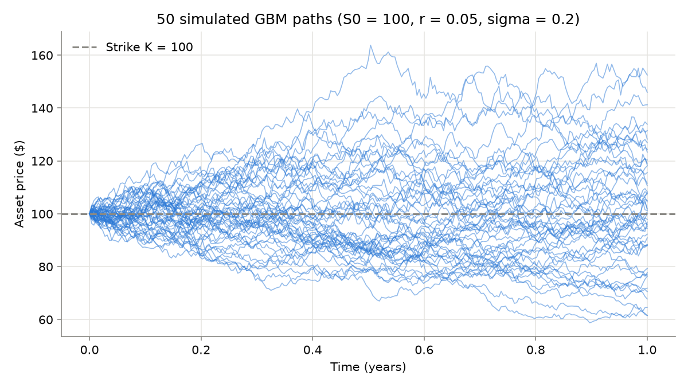
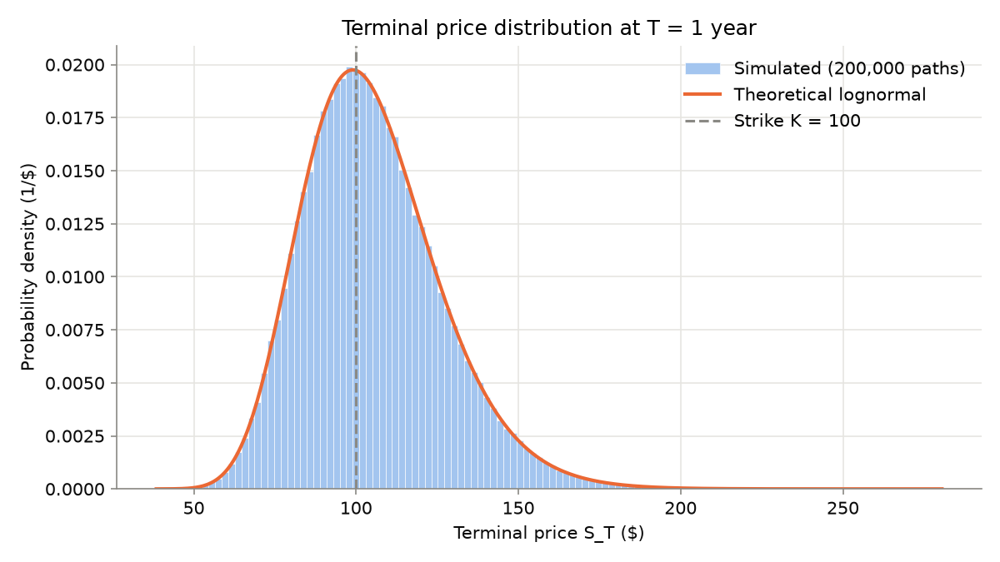
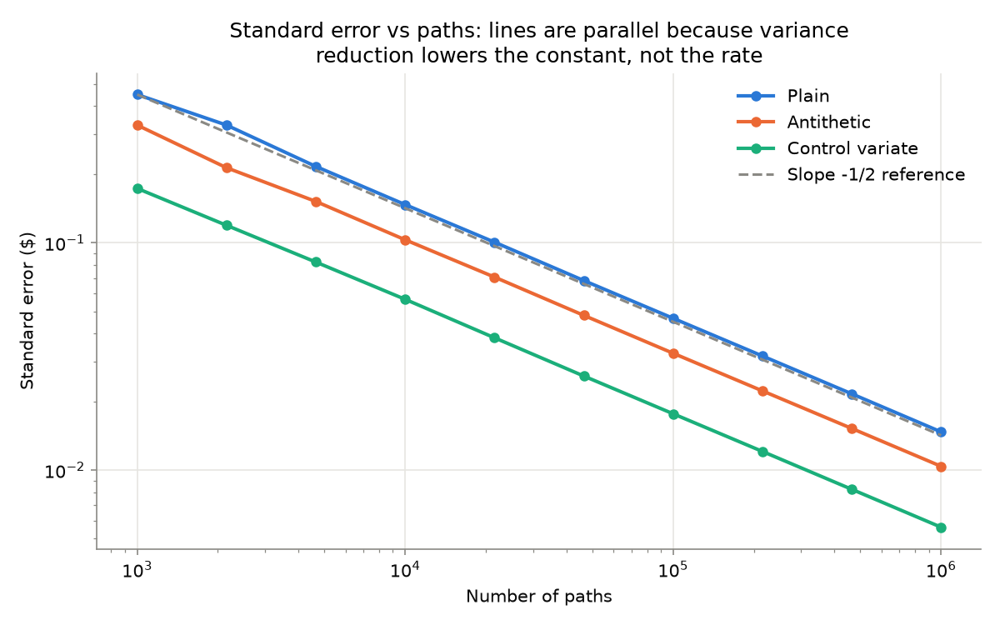
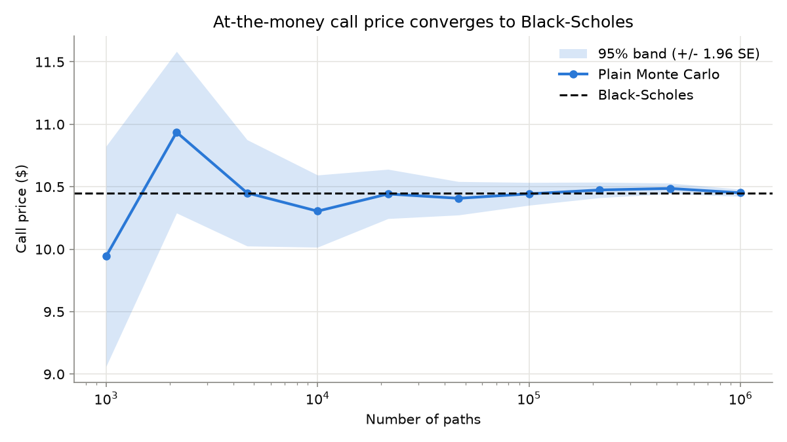
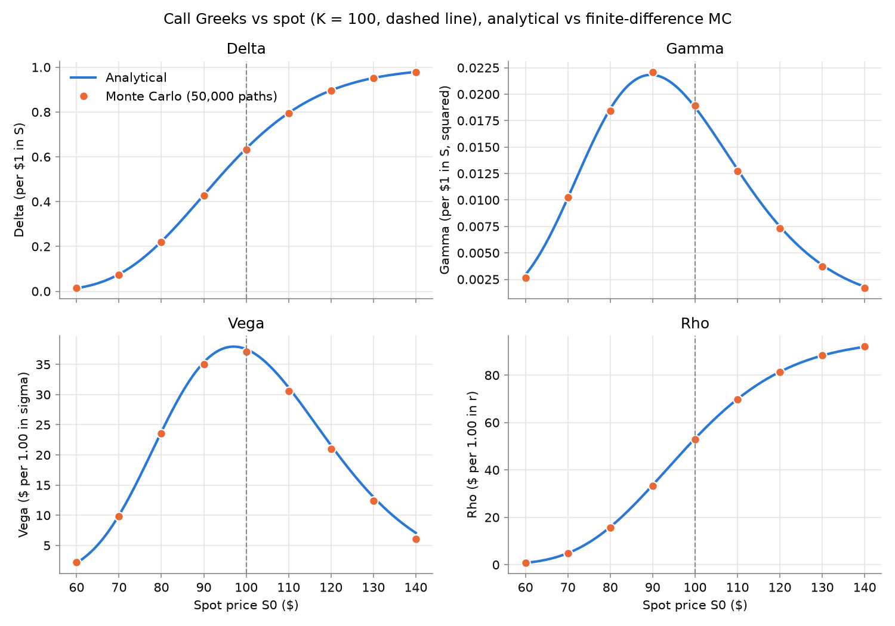
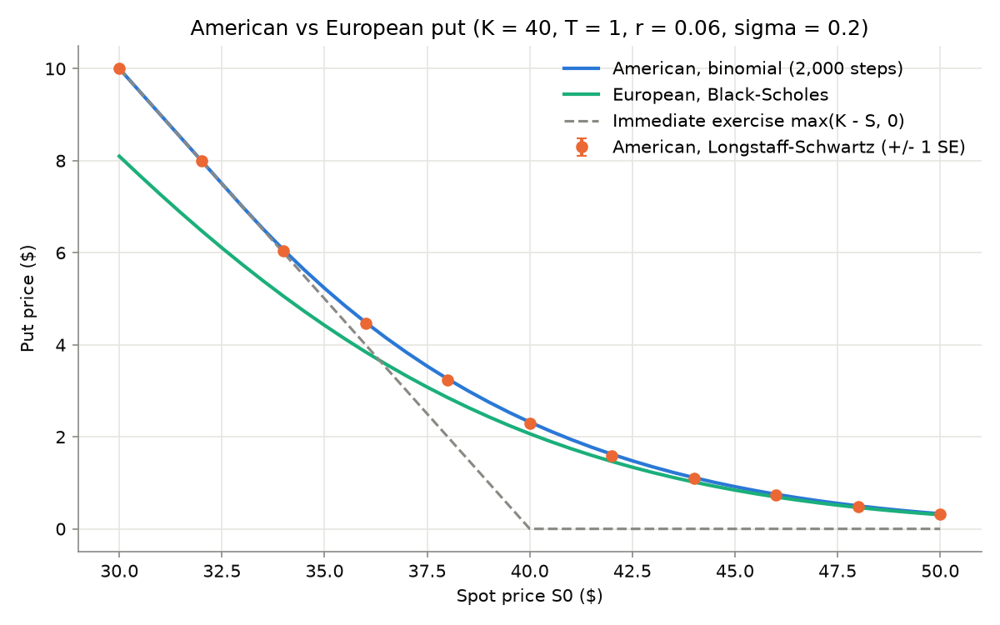
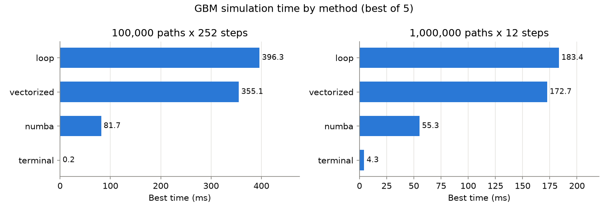

# Monte Carlo Options Pricer

[](https://github.com/RusteenSalehi/monte-carlo-options-pricer/actions/workflows/tests.yml)

A Python engine that prices European and American stock options by simulating many possible future price paths, checked against closed-form and binomial-tree reference answers.

## The idea in plain English

An option is a contract that gives its holder the right, but not the obligation, to buy (a call) or sell (a put) a stock at a fixed price, the strike, on or before a set date. If the stock ends up above the strike, a call is worth the difference; if it ends up below, the call simply expires unused and is worth nothing.

Nobody knows where the stock will be on that date, so the fair price today is an average: the payoff in every possible future, weighted by how likely that future is, and discounted back to today because money later is worth less than money now. For simple contracts there is a formula for this average (Black-Scholes). For others, especially options that can be exercised early, there is no simple formula.

This engine estimates that average by brute force. It simulates hundreds of thousands of random but realistic stock price paths, computes the option's payoff on each, and averages them. It also reports how uncertain that average is, uses statistical tricks to make it more precise for the same effort, measures how the price reacts to market changes (the "Greeks"), and handles options that can be exercised early. Every result is checked against a trusted reference answer.

## Results at a glance

All numbers are from the scripts listed under [How to run](#how-to-run), with seed 42. European results use S0 = 100, K = 100, T = 1, r = 0.05, sigma = 0.2, 12 time steps.

| Result | Value | Meaning |
|---|---|---|
| Monte Carlo vs Black-Scholes, 1,000,000 paths | 10.451541 vs 10.450584 (error 0.000958, standard error 0.014732) | The simulated call price is 0.065 standard errors from the exact answer. |
| Antithetic variates, variance reduction at 1,000,000 paths | 2.009 | Plain Monte Carlo would need about 2.0 times as many paths for the same precision. |
| Control variate, variance reduction at 1,000,000 paths | 6.902 | Plain Monte Carlo would need about 6.9 times as many paths for the same precision. |
| American put, Longstaff-Schwartz vs binomial tree (S0 = 36, K = 40, r = 0.06) | 4.4624 (SE 0.0092) vs 4.4867 | The simulation lands 0.0243 below the reference, as expected from its known downward bias (see [Limitations](#limitations)). |
| Fastest full-path simulator (numba, 100,000 x 252) | 4.2x faster than the Python loop | Same paths, compiled instead of interpreted. |
| Terminal-only simulation (100,000 x 252) | 1175.8x faster than the loop | European options need only the final price, so the intermediate steps can be skipped entirely. |

## Figures


Fifty simulated stock price paths fanning out from S0 = 100, with the strike marked.


The histogram of simulated final prices matches the theoretical lognormal density.


Standard error falls as one over the square root of the number of paths for all three methods; variance reduction shifts the line down without changing its slope.


The plain Monte Carlo call price settles onto the Black-Scholes value as paths increase, with its 95% band narrowing around it.


Finite-difference Monte Carlo Greeks sit on the analytical Black-Scholes curves across a range of spot prices.


The American put is worth more than the European put, and Longstaff-Schwartz tracks the binomial tree; at low spot prices both meet the immediate-exercise line.


Best-of-5 simulation times for each method at the two benchmark configurations.

## How it works

### Geometric Brownian motion and its exact discretization

The stock follows geometric Brownian motion under the risk-neutral measure, $dS_t = r S_t\,dt + \sigma S_t\,dW_t$. Its solution gives an exact update over any step $\Delta t$:

$$S_{t+\Delta t} = S_t \exp\!\left(\left(r - \tfrac{\sigma^2}{2}\right)\Delta t + \sigma\sqrt{\Delta t}\,Z\right), \qquad Z \sim N(0,1).$$

Because this is exact rather than an Euler approximation, there is no time-discretization error: more steps add exercise dates for American options, not accuracy for European ones. The standard normals $Z$ are generated once and passed in, so the same shocks can be reused.

### Monte Carlo and the $1/\sqrt{N}$ standard error

The price is the discounted average payoff over $N$ simulated paths, with a standard error from the sample standard deviation $s$:

$$\hat V = e^{-rT}\frac{1}{N}\sum_{i=1}^{N} f\big(S_T^{(i)}\big), \qquad \mathrm{SE} = \frac{s}{\sqrt N}.$$

Halving the error takes four times as many paths. Every pricer returns the estimate together with its standard error and path count, so each price comes with its own uncertainty.

### Antithetic variates

For each draw $Z$ the engine also uses $-Z$ and averages the two payoffs:

$$\hat V_{\text{anti}} = \frac{1}{N/2}\sum_{i=1}^{N/2} \frac{f\big(S_T(Z_i)\big) + f\big(S_T(-Z_i)\big)}{2}.$$

For a payoff that rises with the stock price, the two halves of a pair are negatively correlated, so their average varies less than either one. The pairs are not independent internally, so the standard error is computed over the $N/2$ pair averages.

### Control variates

The discounted terminal stock price $X = e^{-rT}S_T$ has a known mean, $S_0$, and is strongly correlated with the call payoff $Y$. The estimator subtracts the part of $Y$'s error that $X$ predicts:

$$\hat V_{\text{cv}} = \frac{1}{N}\sum_{i=1}^{N}\Big(Y_i - b\,(X_i - S_0)\Big), \qquad b = \frac{\mathrm{Cov}(Y, X)}{\mathrm{Var}(X)}.$$

$b$ is estimated from the same sample, which adds a small bias that vanishes as $N$ grows.

### Greeks with common random numbers, and pathwise delta

Finite-difference Greeks re-price the option with a bumped input, for example

$$\Delta \approx \frac{V(S_0 + h) - V(S_0 - h)}{2h},$$

and likewise for gamma, vega and rho. Every bumped price reuses the same shocks $Z$. With fresh random numbers, the noise in each price would swamp the small difference between them. The pathwise method instead differentiates the payoff along each path, giving a delta estimate with its own standard error and no bump size:

$$\Delta_{\text{pathwise}} = e^{-rT}\,\mathbb{E}\!\left[\mathbf{1}\{S_T > K\}\,\frac{S_T}{S_0}\right].$$

### Longstaff-Schwartz for American options

An American option can be exercised at any step, so on each path the holder must compare exercising now with the value of waiting. Working backward in time, Longstaff-Schwartz estimates the value of waiting by regressing discounted future cashflows on a polynomial in $S_t/K$:

$$C(S_t) \approx \sum_{k=0}^{d} \beta_k \left(\frac{S_t}{K}\right)^k,$$

fitted only on paths that are in the money, where the decision is real. A path exercises when the immediate payoff exceeds $C(S_t)$. Because this exercise rule is a fitted approximation of the optimal one, the estimate is biased low.

### Binomial tree reference

The Cox-Ross-Rubinstein tree moves the stock up by $u = e^{\sigma\sqrt{\Delta t}}$ or down by $d = 1/u$ with risk-neutral probability $p = (e^{r\Delta t} - d)/(u - d)$, and values the option backward with an early-exercise check at every node:

$$V = \max\!\Big(\text{payoff}(S),\; e^{-r\Delta t}\big(p V_{\text{up}} + (1-p) V_{\text{down}}\big)\Big).$$

With many steps it converges to the true American price, so it is the reference answer for American options in the same way Black-Scholes is for European ones.

## Validation

Correctness is tested against known answers rather than against earlier outputs:

- **Black-Scholes.** Plain, antithetic and control variate Monte Carlo prices must lie within 3 standard errors of the closed-form price, and the variance-reduced estimators must have smaller standard errors than plain Monte Carlo.
- **Put-call parity.** The Black-Scholes call and put satisfy $C - P = S - Ke^{-rT}$ for several parameter sets.
- **Zero volatility.** With $\sigma = 0$ every simulated path must equal $S_0 e^{rt}$ to floating-point rounding, which checks the drift with no randomness involved.
- **Reference simulator.** The vectorized, numba and terminal-only simulators must match the plain loop simulator to floating-point rounding on the same shocks.
- **Binomial reference.** The European tree matches Black-Scholes; the American call equals the European call (early exercise of a call on a non-dividend stock is never optimal); the American put exceeds the European put; and Longstaff-Schwartz must be within 3 standard errors of the tree plus a small fixed allowance for its known low bias.
- **Greeks.** Finite-difference Monte Carlo Greeks must be within a small relative tolerance of the analytical values, and pathwise delta within 3 standard errors.

Exact equality would be the wrong test. A Monte Carlo price is a random estimate, and its distance from the true value is on the order of its standard error. A test demanding equality would always fail, and a test with a fixed tolerance like 0.01 would be too loose at a million paths and too strict at a thousand. Tolerances in units of the standard error scale with the precision actually achieved.

The scripts show this in practice. In `verify_convergence`, the error divided by the standard error stays between 0.065 and 1.128 at every path count. In `verify_greeks` (200,000 paths), the Monte Carlo delta, vega and rho are within 0.2243% of the analytical values, gamma within 1.2101%, and the pathwise call delta is 0.637523 (SE 0.001289) against an analytical 0.636831.

American put, K = 40, T = 1, r = 0.06, sigma = 0.2 (tree 2000 steps; LSM 50 steps, 100,000 paths):

| S0 | Binomial | LSM | LSM SE | European | Early-exercise premium |
|---|---|---|---|---|---|
| 36 | 4.4867 | 4.4624 | 0.0092 | 3.8443 | 0.6424 |
| 38 | 3.2573 | 3.2311 | 0.0094 | 2.8519 | 0.4054 |
| 40 | 2.3194 | 2.2949 | 0.0086 | 2.0664 | 0.2530 |
| 42 | 1.6214 | 1.5991 | 0.0076 | 1.4645 | 0.1569 |
| 44 | 1.1132 | 1.0931 | 0.0065 | 1.0169 | 0.0963 |

LSM is below the tree at every spot, by 0.0201 to 0.0262, consistent with its low bias.

## Performance

Best of 5 runs, seed 42, on Linux aarch64 under WSL. Numba was available; its first call is excluded from timing because it compiles.

| Method | Config (paths x steps) | Best ms | Speedup vs loop | Call price |
|---|---|---|---|---|
| loop | 100,000 x 252 | 545.7 | 1.0x | 10.482858 |
| vectorized | 100,000 x 252 | 284.9 | 1.9x | 10.482858 |
| numba | 100,000 x 252 | 129.4 | 4.2x | 10.482858 |
| terminal | 100,000 x 252 | 0.5 | 1175.8x | 10.482858 |
| loop | 1,000,000 x 12 | 219.8 | 1.0x | |
| vectorized | 1,000,000 x 12 | 139.9 | 1.6x | |
| numba | 1,000,000 x 12 | 69.9 | 3.1x | |
| terminal | 1,000,000 x 12 | 5.1 | 42.9x | |

| Config | Full paths (MB) | Terminal only (MB) |
|---|---|---|
| 100,000 x 252 | 202.4 | 0.8 |
| 1,000,000 x 12 | 104.0 | 8.0 |

All four methods give the same call price. The key insight is that under GBM the distribution of the final price is known exactly, so a European option needs one draw per path, not one per step. Since the terminal shock can be built as the sum of a path's step shocks divided by $\sqrt{n}$, it reproduces the loop's final prices, and a 252-step simulation collapses to a single step. Full paths are still needed for American options, where the exercise decision happens along the way.

## Design decisions

- **Shocks are an input and full paths are stored.** Passing the normals $Z$ in makes runs deterministic and testable, and lets antithetic variates and common-random-number Greeks reuse exactly the same shocks. Storing full paths is what American options need.
- **Pricers return price, standard error and path count, not a bare number.** A Monte Carlo price without its uncertainty cannot be judged or tested.
- **Antithetic standard error is computed over pair averages.** The two payoffs in a pair are correlated, so treating them as independent would misstate the error.
- **The control variate is the discounted terminal stock price, with $b$ estimated from the same sample.** Its mean is known exactly ($S_0$) and it is highly correlated with the payoff; estimating $b$ in-sample keeps the method simple at the cost of a small bias that vanishes with more paths.
- **Finite-difference Greeks always use common random numbers.** Without them, simulation noise dominates the tiny price differences being measured.
- **Longstaff-Schwartz regresses on in-the-money paths only, with powers of $S/K$.** Out-of-the-money paths have no exercise decision and would distort the fit; scaling by $K$ keeps the regression well-conditioned.
- **The binomial tree is the reference for American options**, as Black-Scholes is for European options, so the simulation is always checked against an independent method.
- **The plain loop simulator stays as the reference implementation.** It is the easiest version to read and verify, and every faster simulator is tested against it.
- **Random numbers come from `np.random.default_rng`**, NumPy's current generator API, never the legacy global `np.random` functions.

## Limitations

- **Constant volatility.** GBM assumes one fixed volatility; real markets show volatility that changes over time and differs by strike (the volatility smile).
- **No dividends.** The model assumes the stock pays none. With dividends, early exercise of American calls can become optimal, and these prices would not account for it.
- **Longstaff-Schwartz is biased low.** Its exercise rule is a regression approximation of the optimal rule, so it underestimates the American price, as the table above shows.
- **Finite-difference Greeks are biased.** A finite bump approximates a derivative with an error that depends on the bump size; gamma, a second difference, is the noisiest of the four.
- **Model risk.** Every result here is exact only within the GBM model. Real price moves include jumps and fat tails that GBM does not capture, so a correct price under GBM can still be wrong for the market.

## Project structure

```
monte-carlo-options-pricer/
├── .github/workflows/
│   └── tests.yml                          CI: pytest on Python 3.10 and 3.12
├── src/
│   ├── gbm.py                             GBM shocks and path simulators (loop reference, vectorized, terminal-only)
│   ├── gbm_numba.py                       Numba-compiled loop simulator, optional at runtime
│   ├── monte_carlo.py                     European pricers: plain, antithetic, control variate
│   ├── black_scholes.py                   Closed-form European call and put prices
│   ├── greeks.py                          Analytical, finite-difference and pathwise Greeks
│   ├── american.py                        Longstaff-Schwartz American option pricer
│   └── binomial.py                        Cox-Ross-Rubinstein binomial tree
├── tests/
│   ├── test_gbm.py                        Simulator shape, determinism and agreement with the loop
│   ├── test_monte_carlo.py                Pricers vs Black-Scholes, variance reduction
│   ├── test_black_scholes.py              Put-call parity
│   ├── test_greeks.py                     Greeks vs analytical values
│   └── test_american.py                   Binomial tree and Longstaff-Schwartz checks
├── scripts/
│   ├── verify_convergence.py              Monte Carlo price and error vs Black-Scholes by path count
│   ├── compare_variance_reduction.py      Plain vs antithetic vs control variate
│   ├── verify_greeks.py                   Monte Carlo Greeks vs analytical
│   ├── compare_american.py                Longstaff-Schwartz vs binomial vs European
│   └── make_plots.py                      Generates every figure in results/
├── benchmarks/
│   └── performance.py                     Simulator timing and memory benchmark
├── results/
│   ├── benchmarks.csv                     Timing results written by the benchmark
│   ├── sample_paths.png                   Simulated GBM paths
│   ├── terminal_distribution.png          Terminal prices vs lognormal density
│   ├── convergence.png                    Standard error vs paths for each method
│   ├── price_convergence.png              Call price converging to Black-Scholes
│   ├── greeks_vs_spot.png                 Greeks vs spot, analytical and Monte Carlo
│   ├── american_vs_european.png           American vs European put prices
│   └── benchmarks.png                     Simulator timings
├── .gitignore                             Ignores the virtual environment and Python/pytest caches
├── CLAUDE.md                              Project rules and design decisions
├── pytest.ini                             Lets bare pytest import src
├── requirements.txt                       Dependencies
└── README.md
```

## How to run

Requires Python 3.10+. Run everything from the repository root.

```bash
python -m venv .venv
source .venv/bin/activate          # Windows: .venv\Scripts\activate
python -m pip install -r requirements.txt

pytest

python -m scripts.verify_convergence
python -m scripts.compare_variance_reduction
python -m scripts.verify_greeks
python -m scripts.compare_american
python -m benchmarks.performance   # also writes results/benchmarks.csv
python -m scripts.make_plots       # regenerates the figures in results/
```

Numba is listed in `requirements.txt` but is optional at runtime: if it cannot be imported, the numba test is skipped and the benchmark leaves it out.

## References

- Glasserman, P. *Monte Carlo Methods in Financial Engineering*. Springer, 2003.
- Longstaff, F. A., and Schwartz, E. S. "Valuing American Options by Simulation: A Simple Least-Squares Approach." *Review of Financial Studies* 14(1), 2001.
- Hull, J. C. *Options, Futures, and Other Derivatives*. Pearson.
- Cox, J. C., Ross, S. A., and Rubinstein, M. "Option Pricing: A Simplified Approach." *Journal of Financial Economics* 7(3), 1979.
